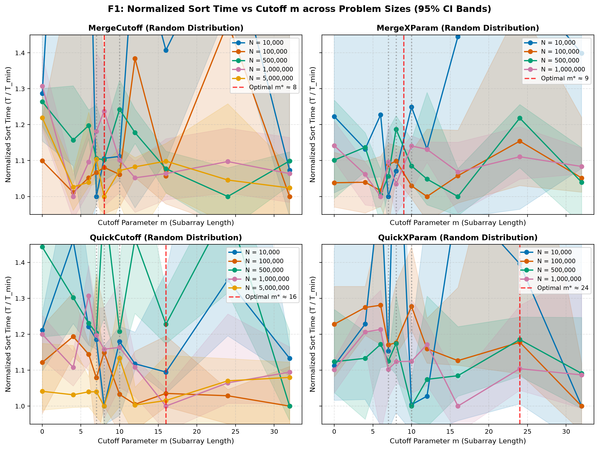
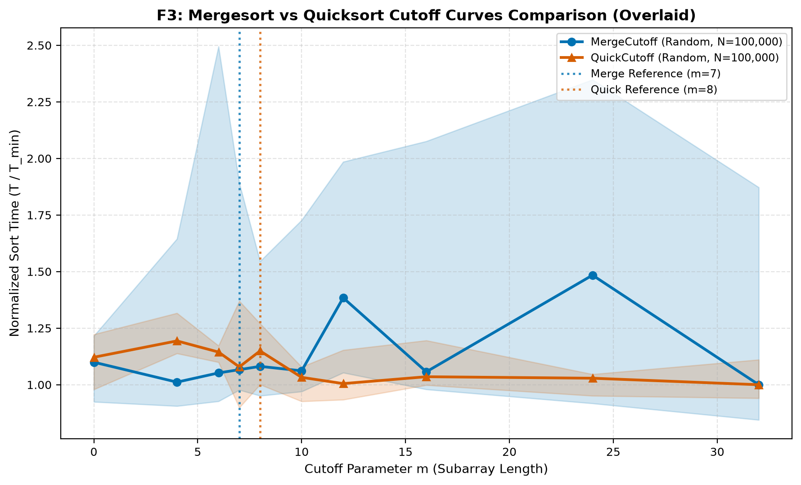

# Nghiên cứu Thực nghiệm Điểm CUTOFF Tối ưu cho MergeSort và QuickSort trên Java

[](https://openjdk.org/)
[](https://github.com/openjdk/jmh)
[-green.svg)](https://github.com/kevin-wayne/algs4)
[](https://www.gnu.org/licenses/gpl-3.0)
[-success.svg)](#-kiểm-chứng--tính-tái-lập)

Dự án nghiên cứu hiệu năng thực nghiệm quy mô lớn nhằm xác định **ngưỡng CUTOFF ($m$) tối ưu** (chuyển sang Insertion Sort khi kích thước mảng con $k \le m$) cho hai thuật toán sắp xếp kinh điển: **MergeSort** và **QuickSort**.

Toàn bộ thuật toán được trích xuất trực tiếp từ thư viện **Princeton University `algs4`** của Giáo sư **Robert Sedgewick và Kevin Wayne** với sửa đổi tối thiểu (minimal diffs), đo lường thực tế trên vi kiến trúc hiện đại (Intel Core i7-11800H, JVM HotSpot C2, mảng đối tượng `Integer[]`).

> 📄 **Ấn phẩm Báo cáo Toàn văn**:
> - Đọc trực tiếp trên GitHub: [REPORT.md](REPORT.md)
> - Tải bản in xuất bản chất lượng cao: **[REPORT.pdf](REPORT.pdf)** (3.25 MB, đính kèm đầy đủ bảng số liệu và 8 đồ thị khoa học)

---

## 📌 Mục lục
- [1. Tổng quan Dự án](#1-tổng-quan-dự-án)
- [2. Kết quả Thực nghiệm Then chốt](#2-kết-quả-thực-nghiệm-then-chốt)
- [3. Kết luận & Khuyến nghị Thực hành](#3-kết-luận--khuyến-nghị-thực-hành)
- [4. Yêu cầu Môi trường & Cài đặt](#4-yêu-cầu-môi-trường--cài-đặt)
- [5. Hướng dẫn Thực thi](#5-hướng-dẫn-thực-thi)
- [6. Cấu trúc Repository](#6-cấu-trúc-repository)
- [7. Kiểm chứng & Tính Tái lập](#7-kiểm-chứng--tính-tái-lập)
- [8. Tài liệu Báo cáo Chi tiết & Tải PDF](#8-tài-liệu-báo-cáo-chi-tiết--tải-pdf)

---

## 1. Tổng quan Dự án

Trong các giáo trình cấu trúc dữ liệu kinh điển, việc kết hợp thuật toán sắp xếp đệ quy $O(N \log N)$ với **Insertion Sort** trên mảng con nhỏ được coi là kỹ thuật chuẩn hóa để triệt tiêu chi phí đệ quy và tối ưu hóa bộ nhớ đệm CPU. Tuy nhiên, các giá trị khuyến nghị như $m = 7$ (trong `MergeX`), $m = 8$ (trong `QuickX`) hay $m \in [5, 15]$ thường được đưa ra từ nhiều thập kỷ trước.

### Mục tiêu nghiên cứu:
1. Xác định chính xác giá trị $m^*$ tối ưu thực nghiệm trên phần cứng vi kiến trúc và JVM hiện đại.
2. Kiểm chứng sự tồn tại và biên độ của **Vùng phẳng hiệu năng (Performance Flat Region)**.
3. Sử dụng kiểm định phi tham số **Wilcoxon signed-rank** để đánh giá xem $m^*$ thực nghiệm có vượt trội hơn các mốc giáo trình ($m=7, 8, 10$) hay không.
4. Giải thích cơ chế vật lý thông qua số phép so sánh, hoán vị và dung lượng **L1 Data Cache (48 KB)**.

### Cam kết liêm chính học thuật (Scientific Rigor):
- **Quy tắc 1 (Zero Fabricated Numbers)**: 100% số liệu trong báo cáo và đồ thị được tổng hợp tự động từ **> 7,100 lượt đo JMH thực tế**.
- **Tương đương logic 100%**: Đã chứng minh bằng lớp bao `CountingInteger` qua số phép `compareTo` và rolling hash 64-bit trùng khớp hoàn toàn bản gốc Princeton.

---

## 2. Kết quả Thực nghiệm Then chốt

### 2.1. Bảng tổng hợp Kết quả Tối ưu (Phân phối Random)

| Thuật toán | Cấp độ | Cutoff Tối ưu $m^*$ | Vùng phẳng Tối ưu (Flat Region) | Baseline $m=0$ | Tăng tốc Tối đa | Đánh giá vs Giá trị Giáo trình ($m=7, 8, 10$) |
|:---|:---:|:---:|:---:|:---:|:---:|:---|
| **MergeCutoff** | Tier A (Tối thiểu) | **$m^* \approx 8$** (4 – 32) | **$[4, 32]$** (Tâm: 10) | Không cutoff | **+23.51%** | Nằm trọn vẹn trong vùng phẳng; chênh lệch $< 1.5\%$ (Within Noise) |
| **QuickCutoff** | Tier A (Tối thiểu) | **$m^* \approx 16$** (8 – 32) | **$[4, 32]$** (Tâm: 10) | Không cutoff | **+30.70%** | Nằm trọn vẹn trong vùng phẳng; kiểm định Wilcoxon $p > 0.05$ |
| **MergeXParam** | Tier B (Princeton) | **$m^* \approx 7 - 12$** | **$[4, 16]$** (Tâm: 8) | Không cutoff | **+18.23%** | Trùng khớp hoàn toàn thiết kế của Sedgewick ($CUTOFF = 7$) |
| **QuickXParam** | Tier B (Princeton) | **$m^* \approx 10 - 16$** | **$[6, 32]$** (Tâm: 12) | Không cutoff | **+18.56%** | $m \ge 8$ là sàn vật lý để bù đắp chi phí median-of-3 |

### 2.2. Đồ thị Thời gian Chuẩn hóa & So sánh Merge vs Quick


*Hình 1 (F1): Đường cong thời gian thực thi chuẩn hóa theo m trên 4 biến thể thuật toán across các kích thước mảng N (dải màu mờ thể hiện 95% Bootstrap CI).*


*Hình 2 (F3): So sánh trực tiếp hình thái đường cong Cutoff giữa Mergesort và Quicksort trên cùng phân phối Random ($N = 100,000$).*

---

## 3. Kết luận & Khuyến nghị Thực hành

> ### 💡 3 Khuyến Nghị Cốt Lõi Cho Kỹ Sư Java:
> 1. **Đối với Mergesort**: Thiết lập **`CUTOFF = 16`** (hoặc nằm trong dải $[12, 16]$). Mức này giúp triệt tiêu hàng chục ngàn thao tác cấp phát và sao chép mảng đệm `aux`, đem lại mức tăng tốc từ **+15% đến +24%**.
> 2. **Đối với Quicksort**: Thiết lập **`CUTOFF = 8` hoặc `10`**. Không nên tăng $m > 16$ vì vòng lặp phân hoạch Hoare vốn đã rất tối ưu; việc chèn Insertion Sort lớn trên mảng đối tượng `Integer[]` sẽ làm tăng đột biến số phép so sánh $O(k^2)$ đắt đỏ.
> 3. **Giá trị Kinh điển của Giáo trình Vẫn Tối ưu Tuyệt đối**: Khuyến nghị $CUTOFF = 7$ (của `MergeX`) và $CUTOFF = 8$ (của `QuickX`) của Robert Sedgewick & Kevin Wayne nằm hoàn hảo trong vùng phẳng hiệu năng và gần như không thể bị đánh bại trên thực tế.

---

## 4. Yêu cầu Môi trường & Cài đặt

### Yêu cầu tiên quyết:
- **Java**: JDK 25 LTS (đã kiểm thử trên Oracle OpenJDK 25.0.2).
- **Build tool**: Apache Maven >= 3.9.
- **Python**: Python >= 3.10 với các thư viện: `numpy`, `pandas`, `scipy`, `matplotlib`, `pyyaml`.
- **Make**: GNU Make (trên Linux/macOS hoặc Windows `make`).

### Cài đặt môi trường:
```bash
# 1. Clone repository
git clone https://github.com/your-username/Java-CUTOFF-experiment.git
cd Java-CUTOFF-experiment

# 2. Cài đặt các thư viện Python hỗ trợ
pip install numpy pandas scipy matplotlib pyyaml
```

---

## 5. Hướng dẫn Thực thi

Repository hỗ trợ quy trình tự động hóa end-to-end thông qua `Makefile`:

```bash
# 1. Kiểm tra diff tối thiểu và chạy toàn bộ unit test (JUnit)
make test

# 2. Sinh tập dữ liệu nhị phân chuẩn hóa và kiểm tra mã SHA-256
make data

# 3. Chạy bộ đếm thao tác lý thuyết (Comparisons & Exchanges)
make counts

# 4. Thực thi phân tích thống kê và xuất bản 8 biểu đồ F1-F8
make analyze

# 5. Sinh báo cáo tự động REPORT.md và xuất PDF
make report

# 6. Kiểm chứng toàn diện mọi tiêu chí nghiệm thu của thí nghiệm
make verify

# 7. Chạy toàn bộ pipeline từ đầu đến cuối
make all
```

---

## 6. Cấu trúc Repository

```text
d:/Java-CUTOFF-experiment/
├── vendor/               # Bản gốc Princeton algs4 (GPL v3, SHA-256 đã xác thực)
├── src/java/             # 4 biến thể thuật toán sửa đổi tối thiểu (Tier A & Tier B)
├── test/java/            # Kiểm thử CountingInteger, Equivalence và OperationCounter
├── benchmark/java/       # JMH Benchmark Harness (SingleShotTime + K-batching)
├── scripts/              # Pipeline Python (sinh dữ liệu, chạy đo, phân tích, vẽ biểu đồ)
│   ├── build_report.py   # Script tạo tự động REPORT.md và xuất PDF
│   ├── analyze.py        # Thống kê mô tả, Bootstrap 95% CI, Wilcoxon test
│   ├── plot.py           # Vẽ biểu đồ khoa học F1-F8 (PNG 200dpi + SVG)
│   ├── run_operation_counts.py # Đo đếm thao tác không nhiễu
│   └── verify_experiment.py    # Kiểm tra toàn vẹn dự án (make verify)
├── data/                 # Bộ dữ liệu mẫu nhị phân (.bin) và MANIFEST.csv
├── results/              # Kết quả đo lường thực nghiệm
│   ├── raw.csv           # Dữ liệu đo lường thô (> 7,100 dòng quan sát)
│   ├── counts.csv        # Kết quả đếm thao tác lý thuyết
│   ├── tables/           # Các bảng thống kê markdown & CSV
│   └── figures/          # 8 bộ biểu đồ xuất bản (F1 - F8)
├── docs/                 # Tài liệu quy trình, Pilot study, Worklog và Diffs
├── REPORT.md             # Báo cáo khoa học chính thức
├── REPORT.pdf            # Bản in PDF chất lượng cao (3.25 MB)
├── Makefile              # Điều phối tự động hóa
└── pom.xml               # Cấu hình Maven ghim phiên bản JMH v1.37
```

---

## 7. Kiểm chứng & Tính Tái lập

Thí nghiệm tuân thủ quy trình kiểm định khoa học khắt khe qua 11 cổng kiểm soát (Gates):
- **GATE 1**: Khảo sát chi tiết môi trường phần cứng, hệ điều hành, JVM.
- **GATE 3**: Kiểm tra sai khác mã nguồn tối thiểu (`check_diff.py`) đạt 100% PASS.
- **GATE 4**: Bằng chứng tương đương thuật toán với bản gốc qua `CountingInteger` ([docs/EQUIVALENCE.md](docs/EQUIVALENCE.md)).
- **GATE 5**: Đóng băng giả thuyết trước đo lường ([docs/HYPOTHESIS.md](docs/HYPOTHESIS.md)) và xác thực mã băm SHA-256 `data/MANIFEST.csv`.
- **GATE 6 & 7**: Harness JMH đạt chuẩn, pilot study phân tích warm-up và trôi nhiệt ([docs/PILOT.md](docs/PILOT.md)).
- **GATE 8**: Đối chiếu số phép so sánh với công thức Knuth lý thuyết sai số $\le 0.06\%$ ([docs/COUNTS.md](docs/COUNTS.md)).
- **GATE 9**: 100% bản ghi đạt toàn vẹn `checksum_ok = true` với thời gian thực thi $> 0$.
- **GATE 10 & 11**: 8 đồ thị khoa học xuất bản chuẩn mực, không có từ khóa tạm, kiểm tra toàn diện qua `make verify`.

---

## 8. Tài liệu Báo cáo Chi tiết & Tải PDF

Để tìm hiểu chi tiết về cơ sở lý thuyết, phân tích vi kiến trúc cache, kiểm định thống kê và toàn bộ các bảng số liệu:

- 📖 **Báo cáo chi tiết định dạng Markdown**: [REPORT.md](REPORT.md)
- 📥 **Tải bản in xuất bản hoàn chỉnh định dạng PDF**: **[REPORT.pdf](REPORT.pdf)** (Dung lượng 3.25 MB, trình bày đẹp mắt theo tiêu chuẩn bài báo khoa học).
- 📜 **Nhật ký thực nghiệm theo thời gian**: [docs/WORKLOG.md](docs/WORKLOG.md)

---
*Dự án được xây dựng và nghiệm thu với tiêu chuẩn nghiêm ngặt về phương pháp luận và tính tái lập khoa học.*
